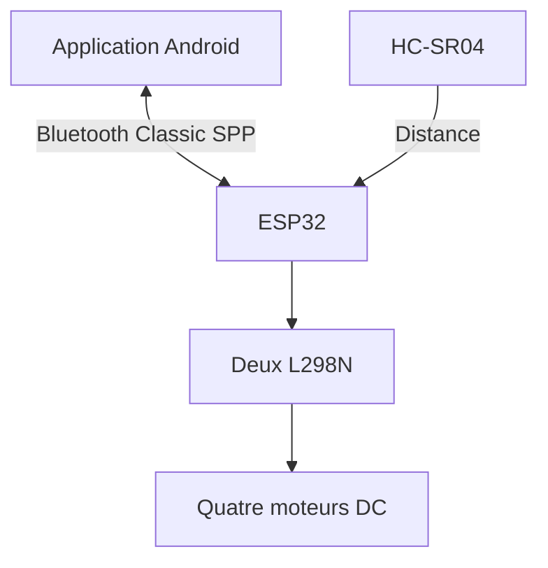

# SmartCar
Voiture intelligente autonome et contrôlée par application mobile
Voiture robotisée ESP32 et Bluetooth

Prototype pédagogique à quatre roues, pilotable depuis une application Android et doté d'un mode d'évitement d'obstacles par capteur ultrason.


## Présentation

SmartCar associe programmation embarquée, commande de moteurs, acquisition de distance et communication Bluetooth. Le mode automatique utilise des règles déterministes : avancer si la distance est supérieure à 25 cm, sinon s'arrêter, reculer brièvement et pivoter. Il ne s'agit pas d'un modèle de machine learning.

## Origine et état des fichiers

La présentation fournie décrit un ESP32, deux L298N, quatre moteurs DC, un HC-SR04 et une application MIT App Inventor. La photo montre le prototype physique. Le fichier `images/interface-concept.jpg` est un visuel d'interface fourni, pas une capture validant une application fonctionnelle.

**Le firmware de ce dépôt est une nouvelle implémentation de référence reconstruite à partir de cette description.** Le code original, le câblage GPIO réel et le projet App Inventor `.aia` n'ont pas été fournis. Le brochage proposé doit être vérifié et adapté au prototype. Aucun résultat de fonctionnement sur matériel n'est revendiqué pour ce nouveau firmware.

La présentation mentionne Aya Karaa et Aya Hichri comme membres de l'équipe. Confirmer les crédits et les contributions individuelles avant publication. Ne pas présenter un travail collectif comme individuel.

## Fonctionnalités du firmware fourni

- Commandes Bluetooth : avancer, reculer, pivoter, arrêter.
- Modes manuel et automatique ; arrêt au démarrage et à la déconnexion.
- Arrêt si les messages de maintien de liaison cessent.
- Arrêt manuel si la commande de mouvement n'est pas renouvelée.
- Distance invalide : arrêt du mode automatique et interdiction d'avancer en manuel.
- Télémétrie textuelle du mode, de la distance et des directions moteur.
- LED externe optionnelle allumée en automatique.

## Matériel

| Élément | Quantité | Remarque |
|---|---:|---|
| ESP32-WROOM-32 DevKit sans PSRAM | 1 | Bluetooth Classic SPP ; vérifier la référence exacte |
| Module L298N | 2 | Un canal par moteur, ENA/ENB activés par cavaliers |
| Moteur DC et roue | 4 | Vérifier tension et courant de blocage |
| HC-SR04 | 1 | ECHO adapté au niveau logique 3,3 V |
| Châssis, batterie, interrupteur et câbles | Selon montage | Alimentation dimensionnée aux moteurs |
| Résistances 1 kΩ et 2 kΩ | 1 de chaque | Pont diviseur ECHO |
| LED et résistance 330 Ω | Optionnel | Indication du mode AUTO |

## Architecture



Le prototype communique localement par Bluetooth. Il n'implémente ni cloud ni MQTT.

## Démarrage

1. Lire [le câblage](docs/WIRING.md), vérifier la carte et adapter `firmware/SmartCar/config.h`.
2. Installer Arduino IDE et le paquet de cartes **esp32 by Espressif Systems**.
3. Ouvrir `firmware/SmartCar/SmartCar.ino`, sélectionner une carte ESP32 classique adaptée et son port USB.
4. Compiler puis téléverser avec l'alimentation moteur débranchée.
5. Appairer un téléphone Android au périphérique `SMART_CAR`, puis connecter un terminal Bluetooth SPP ou l'application construite selon [le guide mobile](mobile/APP_INVENTOR.md).
6. Tester d'abord roues soulevées. Suivre [la procédure de validation](docs/TEST_PLAN.md).

Le code utilise `BluetoothSerial` fourni par le paquet ESP32 ; aucune bibliothèque ultrason externe n'est nécessaire. ESP32-C3/C6/S3 et S2 ne conviennent pas à cette version Bluetooth Classic. Les GPIO 16/17 proposés ne conviennent pas aux variantes où ils sont réservés à la PSRAM.

## Protocole rapide

| Octet | Action |
|---|---|
| `F` / `B` | Avancer / reculer, en mode manuel |
| `L` / `R` | Pivoter gauche / droite, en mode manuel |
| `S` | Arrêt et retour en manuel |
| `A` / `M` | Activer automatique / manuel arrêté |
| `K` | Maintien de liaison ; ne relance aucun mouvement |

Envoyer `K` toutes les 250 ms. En manuel, répéter la direction toutes les 250 ms pendant l'appui et envoyer `S` au relâchement. Envoyer `A` une seule fois pour entrer en automatique : le répéter réinitialiserait la manœuvre. Détails : [protocole](docs/PROTOCOL.md).

## Organisation

```text
firmware/SmartCar/   Firmware Arduino et configuration GPIO
images/             Photo du prototype et concept d'interface
mobile/             Guide des composants et blocs MIT App Inventor
docs/              Câblage, protocole, tests, publication GitHub
tests/             Vérifications logicielles avec matériel simulé
```

## Validation et limites

Les tests hôtes vérifient la logique avec des substituts Arduino/Bluetooth. Ils ne remplacent ni une compilation avec le toolchain ESP32 ni un essai physique. Le statut et les commandes sont décrits dans `docs/TEST_PLAN.md`.

Le capteur frontal ne couvre pas l'arrière, les côtés ou les chutes. Les reculs et pivots sont temporisés, sans encodeurs, et exigent une zone dégagée. Le L298N fonctionne ici à vitesse fixe, sans PWM. Le Bluetooth sert à une démonstration locale, sans mécanisme applicatif de contrôle d'accès ajouté.

## Documentation complémentaire

- [Publication GitHub et présentation CV](docs/GITHUB_AND_CV.md)
- [Câblage proposé](docs/WIRING.md)
- [Application Android à reconstruire](mobile/APP_INVENTOR.md)
- [Plan de tests](docs/TEST_PLAN.md)

## Références officielles

- [BluetoothSerial Espressif](https://github.com/espressif/arduino-esp32/tree/master/libraries/BluetoothSerial)
- [Documentation Bluetooth Arduino-ESP32](https://docs.espressif.com/projects/arduino-esp32/en/latest/api/bluetooth.html)
- [Fiche technique ESP32](https://documentation.espressif.com/esp32_datasheet_en.html)
- [BluetoothClient MIT App Inventor](https://ai2.appinventor.mit.edu/reference/components/connectivity.html#BluetoothClient)

## Droits et crédits

Aucune licence de redistribution n'est choisie automatiquement. Confirmer l'accord de l'équipe sur les sources et les photos avant de publier ou d'ajouter une licence. Les fichiers fournis ne prouvent pas les contributions individuelles.
